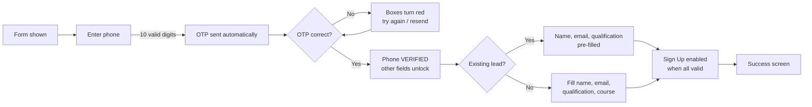
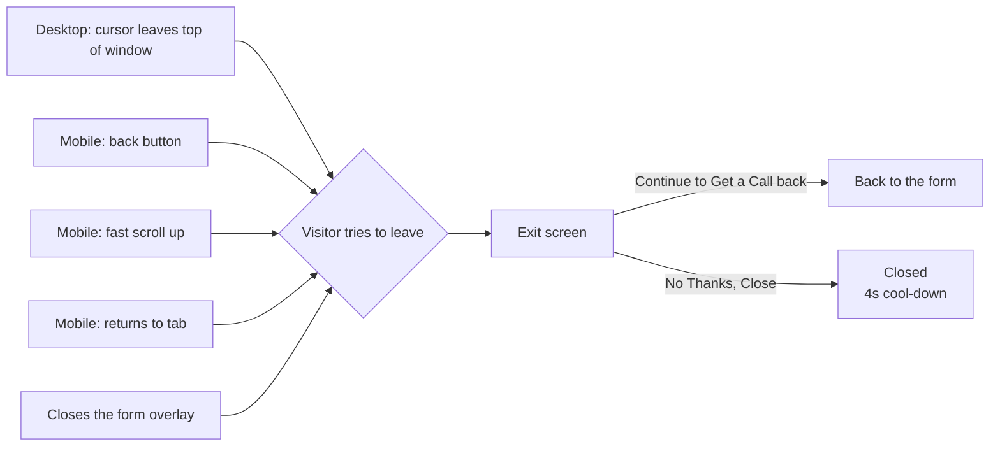

# PRD: Configurable Lead Form

**Owner:** Abhinav Thakur · **Updated:** 7 Nov 2026 · **Status:** Prototype ready for review
**Live prototype:** https://abhinavthak.github.io/dypatil-lead-form/ · **Code:** this repo

---

## 1. Why

University landing pages (starting with DY Patil Online MBA) need **one lead form** that marketing can set up per page
(where it sits, how it looks, how urgent it feels) **without engineering work**, and that verifies phone numbers so
sales only gets real leads.

**We'll know it works when:**

| Metric | What it tells us |
| --- | --- |
| Form start rate = started ÷ viewed | Is the form inviting? |
| Lead conversion = submitted ÷ viewed | Overall performance (main KPI) |
| OTP success = verified ÷ OTP sent | Is verification a blocker? |
| Exit-intent recovery = "Continue" ÷ exit screen shown | Is the exit screen saving leads? |

---

## 2. Where the form appears

One form, several placements. A page can use the **banner** (inline in the hero), an **overlay**, or both.
Both share one state: anything typed in one shows up in the other.

| Desktop banner | Mobile banner |
| --- | --- |
|  |  |

**Overlay styles**

| Popup + side image | Popup + top image | Sidebar | Mobile bottom drawer |
| --- | --- | --- | --- |
|  |  |  |  |

Also available: plain popup, sidebar + top image, bottom drawer + top image, mobile popup.

---

## 3. How the form behaves

| Enter OTP | Wrong OTP | Verified (existing user) | Success |
| --- | --- | --- | --- |
|  |  |  |  |

**Rules**

1. **Phone first.** Name, email, qualification and course are **locked** (greyed, 🔒) until the phone is verified.
   Tapping a locked field sends the user back to the phone/OTP step.
2. **OTP** is sent as soon as a valid 10-digit Indian mobile (starts 6–9) is entered. 4 big boxes, auto-advance,
   paste supported, resend after 30s, **Edit** to change the number.
3. **Existing lead:** after verification we look the number up and pre-fill what we know.
4. **Validation** shows on leaving a field: *Enter Valid Name / Email Id*, *Select Highest Qualification / Course*.
5. **Sign Up** stays grey until every field is valid and the phone is verified.
6. **Success:** "Thank you, {first name}!" with phone, course and a 3-step "What happens next".
   Two versions: *Proceed with My Application* (button) or *A counsellor will call you* (no button).
7. The urgency countdown and seat bar are **display only**; they never block submission.

---

## 4. Exit intent

Shown when a visitor who **hasn't submitted** tries to leave. It shows **every time** they try to leave (not just once).

**Rules**

- **No ✕ button**; clicking outside or pressing Esc does nothing. Only **Continue** or **No Thanks, Close** leave it.
- If the visitor has started, show progress: "Your details · 2 of 5 done".
- Never shown after a successful submit.
- After "No Thanks", passive triggers (cursor, scroll, tab return) wait **4 seconds** before showing it again.
- Mobile back button: first press shows the exit screen; after "No Thanks" the next press leaves the page
  (we never trap users).

---

## 5. Configuration controls

Everything below is set per page through one config object (exportable from the prototype via **Copy config JSON**).

| Area | Control | Options / default |
| --- | --- | --- |
| **Placement** | Banner (inline hero form) | On / Off |
| | Desktop overlay | None · Popup · Popup + side image · Popup + top image · Sidebar · Sidebar + top image |
| | Mobile overlay | None · Bottom drawer · Bottom drawer + top image · Popup |
| | Open overlay | On load · After N seconds (3) · After N% scroll (40) · Only on CTA click |
| | Side / top image | Image URL |
| **Urgency** | Social proof pill | On/Off · count ("146 learners requested a callback today") |
| | Countdown | On/Off · deadline date & time |
| | Seats-filled bar | On/Off · % (82) · batch name |
| **Trust** | Trust strip | On/Off · badges (icon, title, subtitle) |
| | Strip background | Brand tint · Grey · White · Solid brand · **Custom colour** |
| **Look** | Title / subtitle | Text |
| | Primary colour | Any colour (accents, focus, icons) |
| | **CTA colour** | Any colour (Sign Up button; text auto black/white) |
| **Flow** | Verify phone with OTP | On (default) / Off: with Off, fields are never locked |
| | Success screen | Proceed with application · Wait for callback |
| **Exit intent** | Enabled | On / Off |
| | Triggers | Leave intent (cursor / back / scroll / tab) · Closing the overlay |
| | Show progress | On / Off |
| **Data** | Qualification & course lists | Lists of options |
| | Terms / Privacy links | URLs |

---

## 6. Tracking events

Fire to the analytics layer (GTM `dataLayer` / Mixpanel). **Never send phone, name or email in events.**

**Sent with every event:** `page_url`, `program`, `device` (desktop/mobile), `placement` (banner/overlay),
`layout` (e.g. `popup-side-image`), `config_id` (A/B variant), `session_id`, `utm_*`.

| Event | When it fires | Extra properties |
| --- | --- | --- |
| `lf_viewed` | Form is visible on screen (≥ 50% for 1s) | n/a |
| `lf_overlay_opened` | Overlay opens | `trigger`: load / delay / scroll / cta |
| `lf_overlay_closed` | Overlay closes | `stage`: form / success |
| `lf_started` | First interaction with any field | `first_field` |
| `lf_locked_field_tapped` | User taps a locked field | `field` |
| `lf_otp_sent` | OTP requested | `attempt` (1, 2…) |
| `lf_otp_resent` | Resend clicked | `seconds_waited` |
| `lf_otp_failed` | Wrong OTP | `attempt` |
| `lf_otp_verified` | OTP correct | `attempts`, `seconds_to_verify` |
| `lf_phone_edited` | "Edit" on the number | n/a |
| `lf_existing_lead` | Lookup found a past lead | `fields_prefilled` |
| `lf_field_error` | Validation error shown | `field`, `error` |
| `lf_submit_clicked` | Sign Up clicked | `fields_complete` (0–5) |
| `lf_submitted` | Lead saved ✅ (**main conversion**) | `course`, `qualification`, `existing_lead`, `seconds_to_submit` |
| `lf_submit_failed` | API error | `error_code` |
| `lf_success_cta_clicked` | "Proceed with My Application" | n/a |
| `lf_exit_shown` | Exit screen shown | `trigger`: mouse_leave / back / scroll_up / tab_return / close, `progress` (0–5) |
| `lf_exit_continue` | "Continue to Get a Call back" | `progress` |
| `lf_exit_dismissed` | "No Thanks, Close" | `progress` |

**Funnel to build:** `lf_viewed → lf_started → lf_otp_sent → lf_otp_verified → lf_submitted`

---

## 7. Not in this version / open questions

- **Backend:** OTP, lead lookup and submit are mocked in the prototype (OTP `1111` fails; numbers ending `2168` are
  existing leads). Need the real API endpoints and OTP provider.
- **Assets:** the hero images still contain design typos ("AICT APPROVED" twice, "Jan 2025 session"). Need clean re-exports.
- **Tracking:** events above are specified, not yet wired; the component needs an `onEvent` hook.
- **Open:** should OTP be skippable after N failed attempts? Should "Continue" / "Proceed" buttons follow the CTA colour?
