# PRD: Configurable Lead Form

**Owner:** Abhinav Thakur · **Updated:** 7 Nov 2026 · **Status:** Prototype ready for review<br>
**Live prototype:** https://abhinavthak.github.io/dypatil-lead-form/ · **Code:** this repo<br>
**Web version:** https://abhinavthak.github.io/dypatil-lead-form/prd/<br>
**Jira:** [DEG-10697](https://upgrad-jira.atlassian.net/browse/DEG-10697)<br>
**Figma designs:** [D. Y Patil – lead form screens](https://www.figma.com/design/qaf6Kz0KF0k4TEYbwQ0hGB/D.-Y-Patil?node-id=2398-4370&p=f&t=wjuwwmAIwlGHigos-0)

---

## 1. Why

University landing pages (starting with DY Patil Online MBA) need **one lead form** that marketing can set up per page
(where it sits, how it looks, how urgent it feels) **without engineering work**, and that verifies phone numbers so
sales only gets real leads.

**We'll know it works when:**

| Metric | What it tells us |
| --- | --- |
| Form start rate = started ÷ viewed | Is the form inviting? |
| Lead conversion = submitted ÷ viewed | Overall performance (main KPI) |
| OTP success = verified ÷ OTP sent | Is verification a blocker? |
| Exit-intent recovery = "Continue" ÷ exit screen shown | Is the exit screen saving leads? |

---

## 2. Where the form appears

One form, several placements. A page can use the **banner** (inline in the hero), an **overlay**, or both.
Both share one state: anything typed in one shows up in the other.

**Desktop and mobile are set up separately.** Each page picks one desktop overlay and one mobile overlay
(e.g. a popup with side image on desktop + a bottom drawer on mobile). Screens narrower than 760px count as mobile.

### 2a. Desktop

| Banner (in hero, right side) | Banner with image |
| --- | --- |
|  |  |

The banner form can show an **optional promo image across its top**, uploaded by the user (same slot as the
"+ top image" overlays). It shows only with the form, not on the success screen.

| Overlay style | Looks like | Behaviour |
| --- | --- | --- |
| **Popup** | 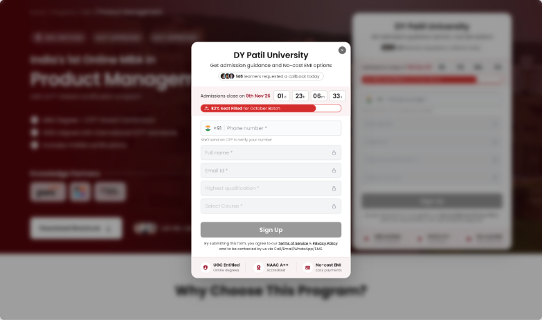 | Centred 420px card, page dimmed and blurred behind |
| **Popup + side image** | 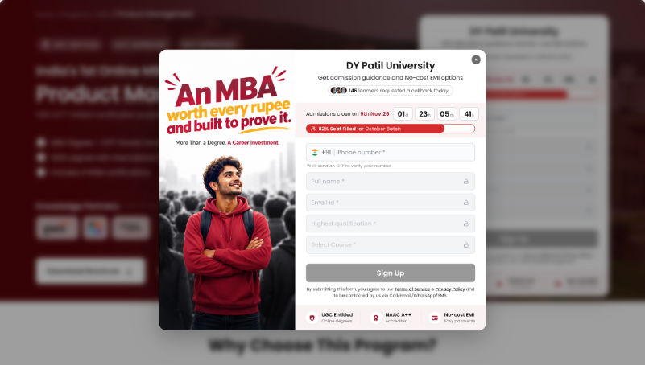 | 725px wide: promo image on the left, form on the right |
| **Popup + top image** | 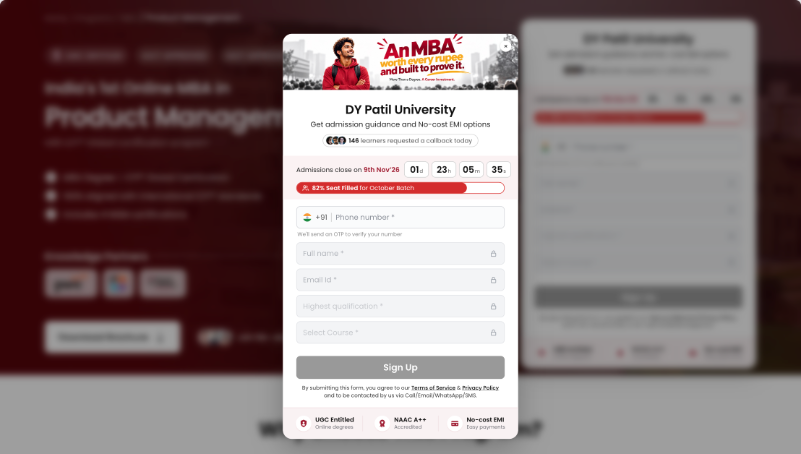 | Popup with a promo banner on top |
| **Sidebar** | 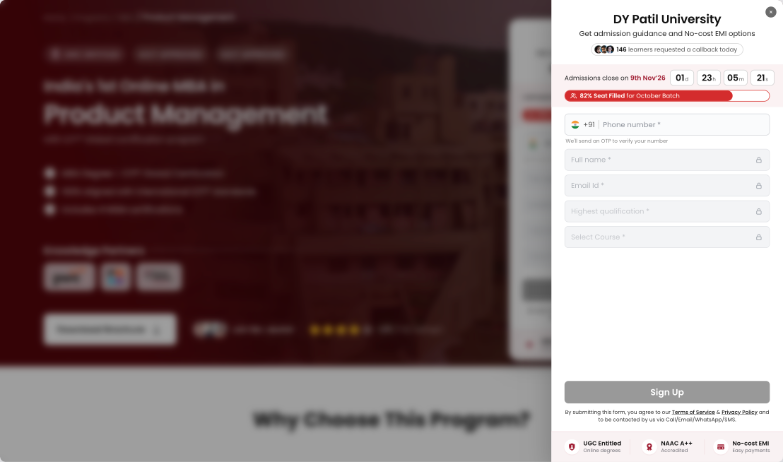 | Slides in from the right, full height, 423px wide |
| **Sidebar + top image** |  | Sidebar with a promo banner on top |
| **None** |  | No overlay opens; visitors use the banner form in the hero |

### 2b. Mobile

| Hero | Banner with image | Bottom drawer | Bottom drawer + top image | Popup |
| --- | --- | --- | --- | --- |
|  | 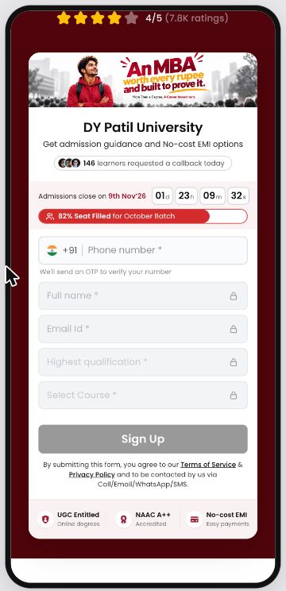 | 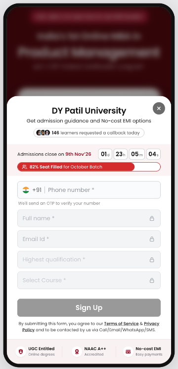 | 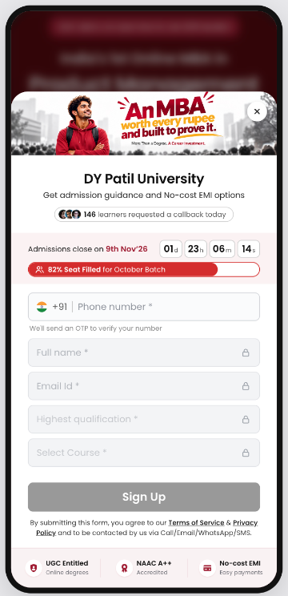 | 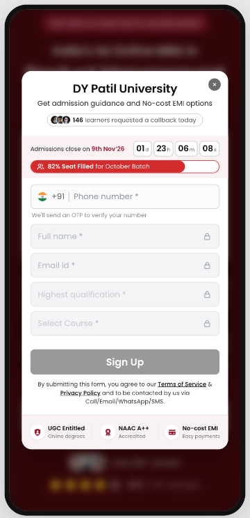 |
| Banner form follows the hero | Optional uploaded image on the banner form | Slides up from the bottom, rounded top, larger ✕ for thumbs | Drawer with promo banner | Centred card, 16px side margins |

**Mobile overlay options:** Bottom drawer · Bottom drawer + top image · Popup · None (banner only).

**Rules for both**

- Promo images show only on the form; success and exit screens are plain cards (no image).
- Overlay opens per the configured trigger (on load, after a delay, after a scroll depth, or only on CTA click),
  and **Download Brochure** / **Apply Now** buttons on the page always open it.

---

## 3. How the form behaves

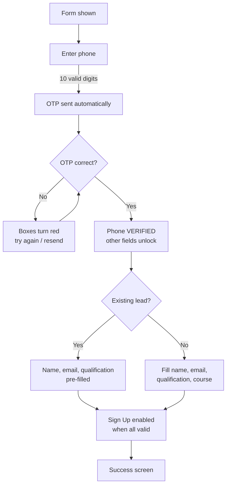

### Step 1: verify the phone (same for everyone)

| Enter OTP | Wrong OTP |
| --- | --- |
| 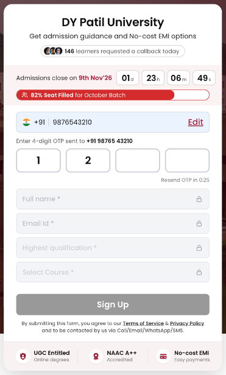 | 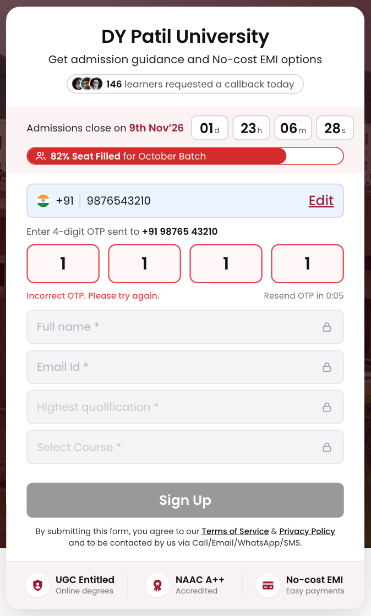 |
| Typing 10 digits sends the OTP. Other fields stay disabled (greyed out). | Boxes turn red, "Incorrect OTP". Typing again starts a fresh attempt; resend after 30s. |

After a correct OTP we check whether this number is already a lead. That decides which journey follows.

### Step 2a: new lead (first time on any of our forms)

| Verified | Typing (with error) | All filled | Success |
| --- | --- | --- | --- |
| 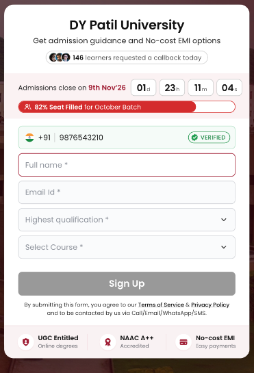 | 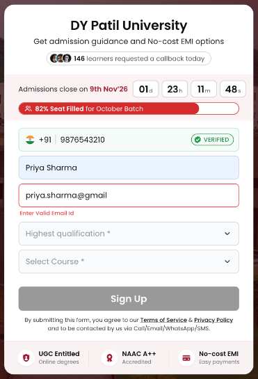 | 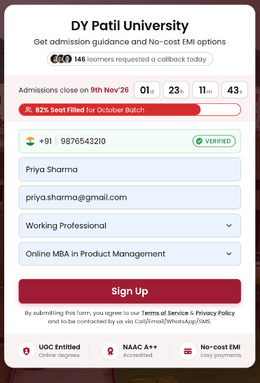 | 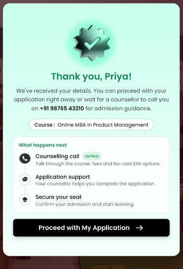 |
| Phone shows **VERIFIED**. Fields unlock **empty** and the cursor jumps to Full name. | Errors appear only after the user types and leaves a field (e.g. "Enter Valid Email Id"). | Every field valid → **Sign Up** turns to the CTA colour. | "Thank you, Priya!" with phone, course and next steps. |

### Step 2b: existing lead (number already in our system)

| Verified + pre-filled | Success |
| --- | --- |
| 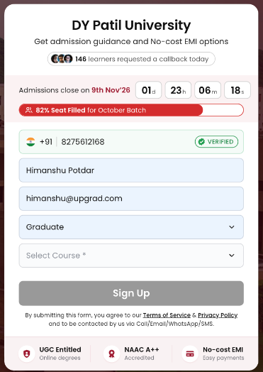 | 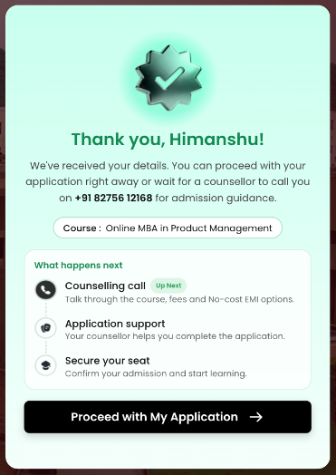 |
| Name, email and qualification are **pre-filled** (light blue) and can still be edited. Usually only Course is left. | Same success screen. Their details are updated, not duplicated. |

**Rules**

1. **Phone first.** Name, email, qualification and course are **disabled** (greyed out, no lock icon) until the phone is verified.
   Tapping a locked field sends the user back to the phone/OTP step.
2. **OTP** is sent as soon as a valid 10-digit Indian mobile (starts 6–9) is entered. 4 big boxes, auto-advance,
   paste supported, resend after 30s, **Edit** to change the number.
3. **New vs existing lead:** after verification we look the number up. New → empty fields; existing → pre-fill
   what we know (the user can still edit it) and update the existing lead on submit.
4. **Validation** shows when the user leaves a field they've typed in (*Enter Valid Name*, *Enter Valid Email Id*).
   Untouched empty fields never show errors; the grey Sign Up already signals "not done".
5. **Sign Up** stays grey until every field is valid and the phone is verified.
6. **Success:** "Thank you, {first name}!" with phone, course and a 3-step "What happens next".
   Two versions: *Proceed with My Application* (button) or *A counsellor will call you* (no button).
7. Urgency elements are **display only**; they never block submission.
8. **Course is pre-selected** from the landing page's configured course (e.g. the Product Management page opens with *Online MBA in Product Management*). Until the phone is verified it shows in **grey** (locked); after verification it turns dark and the visitor can change it from the dropdown; if no course is configured, the dropdown starts empty.

### Lead capture: when details are sent to the CRM

We don't wait for Sign Up. A lead is created **as soon as the phone is verified** and then updated, so partly
filled forms are not lost. All three calls update the **same lead** (matched by `lead_id` / phone); nothing is duplicated.

| # | When | What we send | Lead status |
| --- | --- | --- | --- |
| 1 | **Phone verified** (correct OTP) | Phone + pre-selected course + page context (university, program, form, device, placement, UTMs). For an existing lead, their record is reused | `phone_verified` |
| 2 | **User closes the overlay** before submitting: ✕ / click outside / Esc (incl. "No Thanks, Close" on the exit screen) | Every field filled **up to that point** (name, email, qualification, course) | `partial` |
| 3 | **User clicks Sign Up** (always) | All fields | `submitted` |

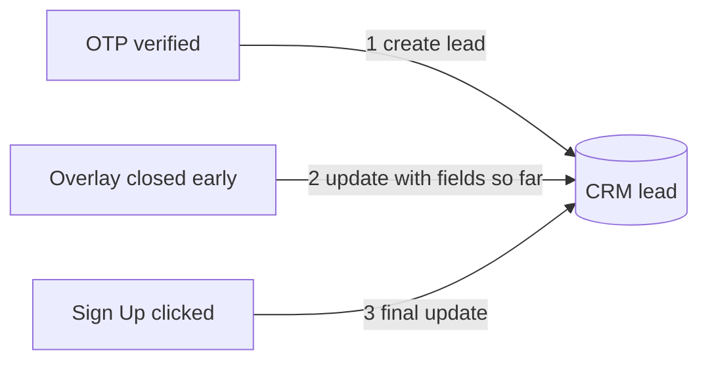

**Rules**

- Nothing is sent before the phone is verified (no lead without a verified number).
- Step 2 sends only fields that have a value; invalid values (e.g. a half-typed email) are sent as typed but flagged
  `invalid` so sales can see them without trusting them.
- Step 2 can happen more than once (close → reopen → close); each sends the latest values.
- Step 3 is required and must succeed: if the submit call fails, show an error and keep the form open with **Retry**.
- A lead marked `submitted` is never downgraded back to `partial` by a later close.

### Urgency elements (up to two at a time)

Each form shows **up to two** urgency elements together (e.g. countdown + seats filled). **None are pre-selected**: marketing turns them on per page. Once two are selected, the
third can't be picked until one is turned off. **Each element** gets its numbers from either **manual** values in the
config or **real-time** data from an API, chosen separately (e.g. countdown manual, seats real-time).

| Element | Shows | Manual data | Real-time data (API returns) |
| --- | --- | --- | --- |
| **Social proof** | "146 learners requested a callback today" pill under the title | Count | `count`: callbacks today |
| **Countdown** | "Admissions close on 9th Nov'26" + live d / h / m / s timer | Deadline date & time | `deadline` (ISO date-time) |
| **Seats filled** | Red progress bar "82% Seat Filled for October Batch" | % filled · batch name | `percent`, `batch` |

- **Real-time** values refresh every N seconds (default 30) and show a small pulsing green **live dot**.
- If the API fails or is slow, the form shows the **manual values as a fallback**, so a real-time element still needs them.
- The countdown ticks every second either way; real-time only changes where the deadline comes from.

---

## 4. Exit intent

Shown **only when someone tries to close the form overlay** before submitting (✕, clicking outside, or Esc). It shows
**every time** they try to close (not just once). It appears inside the popup / sidebar / drawer, replacing the form.

The inline banner form has **no close button**, so it never shows exit intent. Nothing else triggers it: no
cursor-leave detection, no back-button or tab tracking.

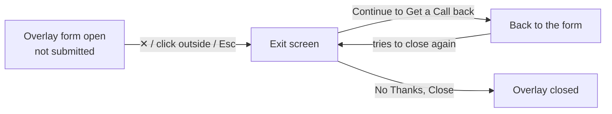

| Desktop | Mobile |
| --- | --- |
|  |  |

**Rules**

- **No ✕ button** on the exit screen; clicking outside or pressing Esc does nothing.
  Only **Continue to Get a Call back** or **No Thanks, Close** leave it.
- If the visitor has started, show progress: "Your details · 2 of 5 done".
- Never shown after a successful submit (closing the success screen just closes).

---

## 5. Configuration controls

Everything below is set per page through one config object (exportable from the prototype via **Copy config JSON**).

| Area | Control | Options / default |
| --- | --- | --- |
| **Placement** | Banner (inline hero form) | On / Off |
| | Banner form image | On / Off · **upload** an image (or URL) |
| | **Desktop** overlay | None · Popup · Popup + side image · Popup + top image · Sidebar · Sidebar + top image |
| | **Mobile** overlay (set independently) | None · Bottom drawer · Bottom drawer + top image · Popup |
| | Open overlay | On load · After N seconds (3) · After N% scroll (40) · Only on CTA click |
| | Side / top promo image | **Upload** an image (or set an image URL) |
| **Urgency** | Urgency elements (**up to two**) | Any two of: Social proof · Countdown · Seats filled · **none selected by default** |
| | Data source, **per element** | **Manual** · **Real-time** (API) |
| | Refresh interval (real-time) | Seconds (30) |
| | Manual values / fallback | Count (146) · deadline · % (82) + batch name |
| **Trust** | Trust strip | On / Off |
| | Badges (**1–3**, editable) | Title · subtitle · icon: built-in (Shield · Award · Card · Graduation cap · Star · People · Briefcase · Clock · Rupee) or **upload** your own |
| | Strip background | Brand tint · Grey · White · Solid brand · **Custom colour** |
| **Look** | Title / subtitle | Text |
| | Primary colour | Any colour (accents, focus, icons) |
| | **CTA text** | Any label (default "Sign Up", e.g. "Get Free Counselling") |
| | **CTA colour** | Any colour (Sign Up button; button text is always white) |
| **Flow** | Verify phone with OTP | On (default) / Off: with Off, fields are never locked |
| | Success screen | Proceed with application · Wait for callback |
| **Exit intent** | Show when the form is closed | On / Off |
| | Show progress | On / Off |
| **Data** | Pre-selected course | One course from the list (per landing page) · None |
| | Qualification & course lists | Lists of options |
| | Terms / Privacy links | URLs |

---

## 6. Tracking events

Every event is pushed to the analytics layer (GTM `dataLayer` → GA4 / Mixpanel) as
`{ event: "form_…", …parameters }`. Names are `snake_case` and every event starts with `form_`.

> **Privacy rule:** never send phone number, name or email in any event. Join with the CRM using `lead_id`.

### 6a. Events

| Event | When it fires | Parameters (besides the common ones) |
| --- | --- | --- |
| `form_viewed` | Form is visible on screen (≥ 50% for 1s) | n/a |
| `form_overlay_opened` | Overlay opens | `open_trigger` |
| `form_overlay_closed` | Overlay closes | `stage` |
| `form_started` | First interaction with any field | `first_field` |
| `form_locked_field_tapped` | User taps a locked field | `field` |
| `form_otp_sent` | OTP requested | `attempt` |
| `form_otp_resent` | "Resend OTP" clicked | `attempt`, `seconds_waited` |
| `form_otp_failed` | Wrong OTP entered | `attempt` |
| `form_otp_verified` | OTP correct | `attempts`, `seconds_to_verify`, `lead_type` |
| `form_phone_edited` | "Edit" on the number | n/a |
| `form_existing_lead` | Lookup found a past lead | `fields_prefilled` |
| `form_field_error` | Validation error shown | `field`, `error` |
| `form_lead_captured` | Lead created or updated in the CRM (phone verified · overlay closed early) | `lead_id`, `lead_stage`, `fields_sent` |
| `form_submit_clicked` | Sign Up clicked | `fields_complete` |
| `form_submitted` | Lead saved ✅ (**main conversion**) | `lead_id`, `lead_type`, `course`, `course_changed`, `qualification`, `seconds_to_submit` |
| `form_submit_failed` | Submit API returned an error | `error_code` |
| `form_success_cta_clicked` | "Proceed with My Application" clicked | `lead_id` |
| `form_exit_shown` | Exit screen shown | `exit_trigger`, `progress` |
| `form_exit_continue` | "Continue to Get a Call back" clicked | `exit_trigger`, `progress` |
| `form_exit_dismissed` | "No Thanks, Close" clicked | `exit_trigger`, `progress` |

**Funnel to build:** `form_viewed → form_started → form_otp_sent → form_otp_verified → form_submitted`

### 6b. Common parameters (sent with every event)

| Parameter | Type | Example | What it is |
| --- | --- | --- | --- |
| `event_id` | string | `"6f1c…"` | Unique ID per event (removes duplicates) |
| `timestamp` | string (ISO 8601) | `"2026-11-07T10:20:31Z"` | When it happened (UTC) |
| `session_id` | string | `"s_8d2a…"` | Visitor's browsing session |
| `form_id` | string | `"dyp-mba-pm-hero"` | Which configured form this is |
| `variant` | string | `"B"` | A/B config variant (`"default"` if none) |
| `university` | string | `"DY Patil University"` | University on the page |
| `program` | string | `"Online MBA in Product Management"` | Program the page is about |
| `page_url` | string | `"https://…/mba-product-management"` | Page URL **without** query string |
| `referrer` | string | `"https://www.google.com/"` | Previous page |
| `device` | enum | `desktop` · `mobile` | Screen < 760px = mobile |
| `placement` | enum | `banner` · `overlay` | Which form surface fired it |
| `urgency_types` | array of enum | `["countdown","seats"]` (0–2 of `social_proof` · `countdown` · `seats`) | Urgency elements shown |
| `urgency_live` | array of enum | `["seats"]` | Elements showing real-time data (a live element that fell back to manual is not listed) |
| `layout` | enum | `popup` · `popup-side-image` · `popup-top-image` · `sidebar` · `sidebar-top-image` · `bottom-drawer` · `bottom-drawer-top-image` · `mobile-popup` · `banner` | Visual style shown |
| `utm_source` · `utm_medium` · `utm_campaign` · `utm_content` · `utm_term` | string | `"google"`, `"cpc"` … | Campaign tags from the landing URL (empty if absent) |

### 6c. Event parameters

| Parameter | Type | Allowed values / example | Used in | What it is |
| --- | --- | --- | --- | --- |
| `open_trigger` | enum | `load` · `delay` · `scroll` · `cta` | overlay_opened | Why the overlay opened |
| `stage` | enum | `form` · `exit` · `success` | overlay_closed | Screen showing when it closed |
| `first_field` | enum | `phone` · `name` · `email` · `qualification` · `course` | started | First field touched |
| `field` | enum | same as above | locked_field_tapped, field_error | Field involved |
| `error` | enum | `invalid_phone` · `invalid_name` · `invalid_email` · `missing_qualification` · `missing_course` | field_error | Which validation failed |
| `attempt` | integer | `1`, `2` … | otp_sent, otp_resent, otp_failed | Count so far for this number |
| `attempts` | integer | `2` | otp_verified | OTP tries needed to verify |
| `seconds_waited` | integer | `34` | otp_resent | Seconds since last OTP was sent |
| `seconds_to_verify` | integer | `21` | otp_verified | Seconds from first OTP sent to verified |
| `lead_type` | enum | `new` · `existing` | otp_verified, submitted | Was the number already a lead? |
| `fields_prefilled` | array of enum | `["name","email","qualification"]` | existing_lead | Fields we filled for them |
| `fields_complete` | integer 0–5 | `5` | submit_clicked | Valid fields at click time |
| `progress` | integer 0–5 | `2` | exit_* | Fields done when exit screen shows |
| `exit_trigger` | enum | `close_button` · `outside_click` · `esc_key` | exit_* | How the visitor tried to close the overlay |
| `lead_id` | string | `"LD-104382"` | lead_captured, submitted, success_cta_clicked | CRM lead ID, returned when the phone is verified |
| `lead_stage` | enum | `phone_verified` · `partial` | lead_captured | Which capture point fired |
| `fields_sent` | array of enum | `["name","email"]` | lead_captured | Fields included in that update |
| `course` | string | `"Online MBA in Product Management"` | submitted | Course selected |
| `course_changed` | boolean | `false` | submitted | Visitor changed the pre-selected course |
| `qualification` | enum | `12th Pass` · `Diploma` · `Graduate` · `Post Graduate` · `Working Professional` | submitted | Highest qualification |
| `seconds_to_submit` | integer | `95` | submitted | Seconds from `form_started` to submit |
| `error_code` | string | `"http_500"` · `"timeout"` · `"otp_provider_down"` | submit_failed | Why submission failed |

**Example: `form_submitted`**

```json
{
  "event": "form_submitted",
  "event_id": "6f1c2b9e-0d6a-4a8e-9b1f-1d2c3e4f5a6b",
  "timestamp": "2026-11-07T10:20:31Z",
  "session_id": "s_8d2a41",
  "form_id": "dyp-mba-pm-hero",
  "variant": "default",
  "university": "DY Patil University",
  "program": "Online MBA in Product Management",
  "page_url": "https://example.com/online-mba-product-management",
  "referrer": "https://www.google.com/",
  "device": "mobile",
  "placement": "overlay",
  "layout": "bottom-drawer",
  "urgency_types": ["countdown", "seats"],
  "urgency_live": ["seats"],
  "utm_source": "google",
  "utm_medium": "cpc",
  "utm_campaign": "mba_pm_nov",
  "utm_content": "",
  "utm_term": "online mba",
  "lead_id": "LD-104382",
  "lead_type": "new",
  "course": "Online MBA in Product Management",
  "qualification": "Working Professional",
  "seconds_to_submit": 95
}
```
